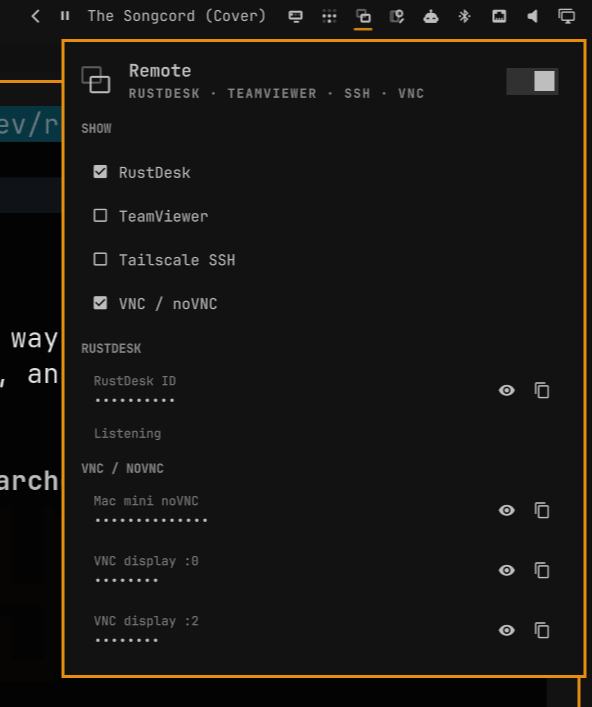

# OmaRemote



Omarchy bar widget for remote access. Plugin id `wizwam.omaremote`.

Shows **RustDesk**, **TeamViewer**, **Tailscale SSH**, and local **VNC/noVNC**.
IDs, IPs, and URLs stay masked until you click the eye. Copy never needs a
reveal. Hover other bar icons for their names — this plugin fills blank
first-party tooltips.

## Install

```bash
omarchy plugin add https://github.com/lukejmorrison/omaremote.git --enable
```

From a checkout:

```bash
./scripts/install-local.sh --section right
```

Place the chip:

```bash
omarchy bar move wizwam.omaremote --section right --after omarchy.tailscale
```

## Clicks

- Left: open the panel
- Right: start/stop the RustDesk user server
- Middle: copy the RustDesk ID (still copies while hidden)
- Eye: reveal or hide that one secret
- Clipboard: copy that secret
- SHOW checkboxes: pick which services appear (saved in `shell.json`)

## Remove

```bash
omarchy plugin disable wizwam.omaremote
omarchy plugin remove wizwam.omaremote --yes
```

## License

MIT. See [LICENSE](LICENSE).
